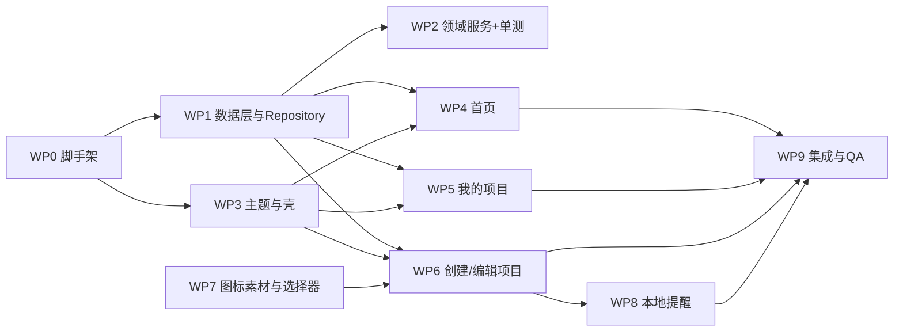

# iBetter 复刻 · 架构与任务分发文档

> 本文档只负责架构和任务拆分，不含实现。执行方（Gemini agent）按第 7 节的工作包领取任务。
> 已确认的决策：**Flutter**、**纯本地 SQLite（离线 MVP）**、**MVP 范围 = 日历首页 + 打卡 + 我的项目 + 创建项目 + 图标库 + 本地提醒**。

## 1. 产品范围

| 截图 | 页面 | MVP |
|---|---|---|
| 1 | 首页：顶部月历（可折叠，选中日高亮）+ 当日项目卡片（勾选打卡） | ✅ |
| 2 | 我的项目：项目卡片，显示累计天数、本月完成天数、连续天数、坚持目标、启停开关 | ✅ |
| 3 | 创建项目：名称、时间规划、坚持目标、起始日期、鼓励语（换一句）、定时提醒、打分、记录心情、每日打卡次数、选择图标 | ✅ |
| 4 | 时间规划：每天 / 每周 / 每周 x 天 / 每月 x 天 | ✅ |
| 5 | 坚持目标：底部滚轮（3、4、7、10 天…、永远） | ✅ |
| 6 | 图标库：按分类分组（追求成就、更健康…） | ✅ |
| - | 底栏的成就（奖杯）、我的、更多 | ⏸ 只放占位页，二期做 |

**不做（一期）：** 账号、云同步、会员、统计图表。

## 2. 技术选型

| 层 | 选型 | 理由 |
|---|---|---|
| 框架 | Flutter 3.x（Dart 3） | 一套代码出 iOS 和 Android，自绘 UI 还原度高 |
| 状态管理 | `flutter_riverpod` | 依赖注入和异步流都方便，易测试 |
| 本地库 | `drift` + `sqlite3_flutter_libs` | 类型安全，支持 Stream 监听，自带迁移 |
| 路由 | `go_router` | 底栏 `StatefulShellRoute` |
| 提醒 | `flutter_local_notifications` + `timezone` + `flutter_timezone` | 本地定时通知 |
| 日期与国际化 | `intl`、`flutter_localizations`（默认 zh-CN，预留 en） | 截图里有 DEC/12月 双语 |
| 测试 | `flutter_test`、`drift` 内存库、`golden_toolkit` 或原生 golden | 领域逻辑必须有单测 |

## 3. 目录结构（feature-first）

```
lib/
  main.dart
  app/                 # App 根、路由、主题
    router.dart
    theme/ (colors.dart, text_styles.dart, app_theme.dart)
  core/
    db/ (app_database.dart, tables.dart, daos/)
    utils/ (date_utils.dart)
    widgets/ (pill_button.dart, section_card.dart, toggle.dart ...)
  domain/              # 纯 Dart，不依赖 Flutter 和 drift，可单测
    models/ (habit.dart, check_in.dart, reminder.dart, schedule.dart)
    services/ (schedule_service.dart, streak_service.dart, stats_service.dart)
  data/
    repositories/ (habit_repository.dart, check_in_repository.dart, reminder_repository.dart)
  features/
    home/              # 日历 + 当日打卡
    projects/          # 我的项目列表
    project_editor/    # 创建/编辑项目、时间规划页、坚持目标滚轮
    icon_picker/       # 图标库
    reminders/         # 通知调度
    placeholders/      # 成就、我的、更多
assets/
  icons/<category>/*.png|svg      # 图标素材
  quotes.json                      # 鼓励语库
test/
```

**分层规则：** UI 只依赖 Repository 和 Provider。Repository 依赖 DAO。`domain/` 不允许 import Flutter 或 drift。

## 4. 数据模型（SQLite / Drift）

### `habits`
| 字段 | 类型 | 说明 |
|---|---|---|
| id | int PK autoinc | |
| name | text | 项目名 |
| icon_key | text | 如 `achievement/trophy` |
| schedule_type | int | 0=每天 1=每周(指定星期几) 2=每周x天 3=每月x天 |
| schedule_value | int | type=2 时为 x(1–7)，type=3 时为 x(1–31)，其余为 0 |
| weekdays_mask | int | type=1 时 bit0=周日…bit6=周六 |
| goal_days | int? | null=永远，否则为目标天数 |
| start_date | text | `yyyy-MM-dd` |
| motto | text | 鼓励语，最长 40 字 |
| enable_score | bool | 打分开关 |
| enable_mood | bool | 记录心情开关 |
| daily_target | int | 每日打卡次数，默认 1 |
| is_active | bool | 项目进行中开关 |
| sort_order | int | |
| created_at | int | epoch ms |

### `check_ins`
`id`、`habit_id` FK（级联删除）、`date`（`yyyy-MM-dd`，**本地日期，不存时区**）、`count`（当日已完成次数）、`score` int?、`mood` int?、`note` text?、`updated_at`。
唯一索引 `(habit_id, date)`，并给 `date` 建索引。

### `reminders`
`id`、`habit_id` FK、`minutes_of_day`（0–1439）、`weekdays_mask`（默认 127）、`enabled`。

> 业务上“已打卡” = `count >= habit.daily_target`。取消打卡时删除该行或把 count 置 0。

## 5. 领域规则（必须有单测）

**5.1 某天是否需要做（`ScheduleService.isScheduledOn(habit, date)`）**
- 每天：`date >= start_date` 即需要做。
- 每周：`weekdays_mask` 命中该星期几。
- 每周 x 天：该周内任意一天都可打卡，目标是满 x 天。周起始日为周日（与截图日历一致）。
- 每月 x 天：同理，按自然月计。

**5.2 完成率与连续天数（`StreakService`）**
- 每天型：连续天数 = 从今天（若今天未打卡则从昨天）往前连续已打卡的天数。
- 每周 x 天、每月 x 天：按“周期”计，连续达标的周期数。
- 每周型：只统计被计划到的日子，没计划的日子不打断连续。
- 暂停（`is_active=false`）期间不计入。

**5.3 统计（`StatsService`，对应“我的项目”卡片）**
- 右上角 Days = 累计打卡天数
- 本月完成天数
- 连续天数
- 坚持目标 = `goal_days` 或“永远”

**5.4 其他**
- 起始日之前的日期不可打卡。未来日期不可打卡。
- 鼓励语：从 `assets/quotes.json` 随机取，“换一句”重新抽，限 40 字。
- 首页某天的圆点或角标：当天有计划的项目是否全部完成。

## 6. 关键 UI 约定

**设计令牌（取自截图，开发时可微调）：**

| 令牌 | 值（近似） |
|---|---|
| 背景 | `#F3EEEE` |
| 主蓝（标题、选中） | `#3B87D6` |
| 项目卡片紫 | `#8E96FF`，底部有 4px 深一档的“立体”阴影 |
| 完成按钮绿 | `#2DB84B`，同样带底部立体阴影 |
| 圆角 | 卡片 16、胶囊按钮 999 |

**首页**
- 月历 7 列 × 5 行（周日起始），选中日用蓝框。右下角有折叠按钮：展开为月，折叠为周。
- 每月 1 日格子里显示 `DEC / 12月`。
- 项目卡片：左图标，中间名称和鼓励语（单行省略），右侧方形勾选框。已完成为半透明白底加对勾。
- 底栏 5 个 tab，今日和成就 tab 可带红点角标（未完成数）。

**创建项目**
- 表单分 4 个卡片分组。时间规划进入二级页，坚持目标用底部滚轮。
- 图标选择区在表单底部，按分类网格展示（5 列）。

> [!WARNING]
> **图标素材的版权：** 不要直接提取或使用 iBetter 的图标。请使用开源素材（如 Microsoft Fluent Emoji、Twemoji、OpenMoji），分类名称和数量可以参考截图。

## 7. 工作包与分发

先由 **WP0 + WP1** 把地基和接口契约定死，其余 WP 才能并行开工。



| WP | 负责内容 | 依赖 | 交付物 / 验收 |
|---|---|---|---|
| **WP0 脚手架** | `flutter create`，加入依赖，建好目录，配置 lint、l10n、`ProviderScope` | 无 | `flutter run` 能跑空壳；`flutter analyze` 零告警 |
| **WP1 数据层** | Drift 表和 DAO，三个 Repository（含 Stream 接口），迁移基线 | WP0 | 内存库单测覆盖增删改查和级联删除 |
| **WP2 领域服务** | `ScheduleService`、`StreakService`、`StatsService`，纯 Dart | WP1 的模型 | 单测覆盖 5.1 到 5.3 的全部规则，含跨月、跨年、跨周边界 |
| **WP3 主题与壳** | 设计令牌、通用组件（胶囊按钮、立体卡片、开关）、`go_router` 底栏、占位页 | WP0 | 5 个 tab 可切换，主题和截图风格一致 |
| **WP4 首页** | 可折叠月历、选中日、当日项目列表、打卡勾选、红点角标 | WP1、WP2、WP3 | 勾选后写库，并实时刷新；起始日之前和未来日期禁用；golden 测试 |
| **WP5 我的项目** | 项目卡片、统计字段、启停开关、点击进入编辑、删除 | WP1、WP2、WP3 | 数字与首页打卡数据一致 |
| **WP6 创建/编辑项目** | 表单、时间规划页、坚持目标滚轮、起始日期选择、鼓励语换一句、打分/心情/次数设置 | WP1、WP3、WP7 | 校验名称必填；创建后首页和项目页立刻出现 |
| **WP7 图标素材与选择器** | 整理开源素材并分类，`IconRegistry`，网格选择器，`quotes.json`（至少 50 句） | WP0 | `iconKey` 到 `Widget` 的映射稳定；缺失时有兜底图 |
| **WP8 本地提醒** | 权限申请，按 `reminders` 调度和取消通知，时区处理，项目停用或删除时清理 | WP6 | Android 和 iOS 真机收到通知；改时间后旧通知被取消 |
| **WP9 集成与 QA** | 端到端用例、边界检查、性能（日历滑动）、打包说明 | 全部 | 验收清单见第 8 节 |

**并行建议：** 第一批 WP0；第二批 WP1、WP3、WP7 并行；第三批 WP2、WP4、WP5、WP6 并行；最后 WP8、WP9。

**接口契约（WP1 必须先发布，其余工作包只依赖它）：**
```dart
abstract class HabitRepository {
  Stream<List<Habit>> watchAll({bool? activeOnly});
  Future<int> create(HabitDraft d);
  Future<void> update(Habit h);
  Future<void> setActive(int id, bool active);
  Future<void> delete(int id);
}
abstract class CheckInRepository {
  Stream<List<CheckIn>> watchByDate(String date);
  Stream<List<CheckIn>> watchByHabit(int habitId);
  Stream<List<CheckIn>> watchByMonth(int year, int month);
  Future<void> setCount(int habitId, String date, int count);
  Future<void> saveDetail(int habitId, String date, {int? score, int? mood, String? note});
}
abstract class ReminderRepository {
  Stream<List<Reminder>> watchByHabit(int habitId);
  Future<void> replaceForHabit(int habitId, List<ReminderDraft> items);
}
```

## 8. 验收清单

- [ ] 创建一个“每天”项目，首页当天能看到并可打卡
- [ ] 打卡后项目页：累计、本月、连续天数正确
- [ ] 补打昨天的卡，连续天数正确
- [ ] 起始日在未来的项目，今天不出现、不可打卡
- [ ] 每周 x 天、每月 x 天的达标判断正确
- [ ] 关闭“项目进行中”后，首页不再显示，连续天数不再增长
- [ ] 修改或删除提醒后，旧通知不会再触发
- [ ] 杀进程重启后，数据完整
- [ ] `flutter analyze`、`flutter test` 全绿

## 9. 给 Gemini 的统一指令（每个 agent 通用前缀）

```
你正在参与复刻习惯养成 App「iBetter」，技术栈 Flutter + Riverpod + Drift(SQLite) + go_router。
请先完整阅读项目根目录 docs/ARCHITECTURE.md，严格遵守第 3 节目录结构、第 4 节数据模型、第 7 节接口契约。
规则：
1. 只做你被分配的工作包（WP），不要修改其他 WP 的文件；确需改动公共契约时，先在 docs/CHANGES.md 记录再改。
2. domain/ 目录不得 import Flutter 或 drift。
3. 图标素材只用开源授权资源，并在 assets/ATTRIBUTION.md 注明来源。
4. 完成后必须跑 flutter analyze 和 flutter test 并保证通过，然后在 docs/PROGRESS.md 追加：WP 编号、完成内容、遗留问题。
5. 日期统一用本地日期字符串 yyyy-MM-dd，不要存时区。
你的任务是：<在此粘贴对应的 WP 行>
```

## 10. 待你决定的事项

1. **UI 语言**：先只做中文，还是同时做中英文？（建议先中文，l10n 框架已预留。）
2. **“每周”的含义**：我按“指定星期几”设计，需要你确认。截图里只有选项名，没有展开页。
3. **二期方向**：成就页（奖杯，对应 N 天里程碑）、统计图表、云同步，优先做哪个？
