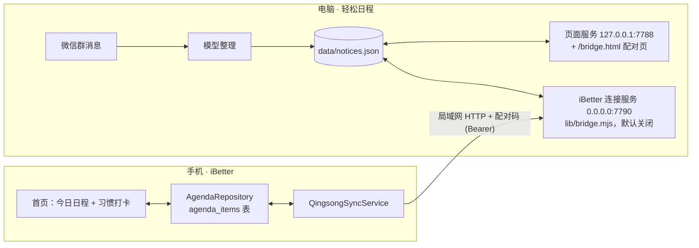

# iBetter × 轻松日程 · 打通架构

> 范围：把电脑上的「轻松日程」（`qwe2017095180-tech/qingsong-rili`，本地 Node 服务，整理微信群通知）和手机上的 iBetter（本仓库，Flutter 离线 App）连起来，并在 iBetter 首页加「今日日程」和添加入口。
> 分工原则和 [ARCHITECTURE.md](ARCHITECTURE.md) 一致：`domain/` 纯 Dart、UI 只依赖 Repository/Provider、日期统一 `yyyy-MM-dd`。

## 1. 两个项目现状

| | 轻松日程 | iBetter |
|---|---|---|
| 运行位置 | Mac / Windows 电脑，`node server.mjs` | Android 手机（APK） |
| 技术 | Node 18+，零依赖；数据 `data/notices.json` | Flutter + Riverpod + Drift(SQLite) |
| 核心对象 | 通知卡片 notice：`id / title / summary / category / deadline / status(new·todo·done·skip) / group` | 习惯 habit + 打卡 check_in |
| 网络 | 页面服务只监听 `127.0.0.1:7788` | 已有 `INTERNET` 权限（用于检查更新） |

问题：手机访问不到只监听 127.0.0.1 的服务；两边也没有「某天要做的事」这个共同概念。

## 2. 总体方案



- **新增一个独立监听端口 7790**，只暴露 `/bridge/v1/*` 这几个接口，必须带配对码；原来的 7788 页面服务保持只监听本机，不受影响。
- 连接服务**默认关闭**，在电脑浏览器打开 `http://127.0.0.1:7788/bridge.html` 点「开启」才会监听局域网。也可以用环境变量 `QS_BRIDGE=1` 启动时直接开启。
- iBetter 仍然**离线优先**：日程先写本地 SQLite，连得上电脑时再双向同步，连不上不影响使用。

## 3. 连接协议（`/bridge/v1`）

所有请求带 `Authorization: Bearer <配对码>`；配对码 8 位，存在电脑的 `data/settings.json → bridgeToken`，可在配对页重置。返回统一是 JSON。

| 方法 | 路径 | 说明 |
|---|---|---|
| GET | `/bridge/v1/ping` | 测试连接，返回 `{ ok, app:'qingsong-rili', version, protocol:1 }` |
| GET | `/bridge/v1/notices` | 全部通知（含已完成/忽略），字段见下 |
| POST | `/bridge/v1/notices` | iBetter 新建的日程写进轻松日程，直接变成「待办」卡片，不走模型 |
| POST | `/bridge/v1/notices/status` | 改状态 `{ id, status: 'todo'\|'done' }`，用于双向勾选完成 |

**通知（下行）字段**：`id, title, summary, category, deadline("YYYY-MM-DD HH:mm"|"YYYY-MM-DD"|null), status, group, createdAt, updatedAt, externalId`。

**新建（上行）请求体**：

```json
{ "items": [ { "clientId": "ib-<uuid>", "title": "交设计表达作业", "date": "2026-11-25", "time": "16:00", "note": "A3 纸 5 个视图" } ] }
```

返回 `{ ok, items: [ { clientId, id } ] }`。服务端按 `externalId = clientId` 去重，重复提交是幂等的。写入的卡片：`status=todo`，`group='iBetter'`，`category='其他'`，`deadline = date + time`。

## 4. iBetter 数据模型

新表 `agenda_items`（schemaVersion 1 → 2，迁移只做 `createTable`）：

| 字段 | 类型 | 说明 |
|---|---|---|
| id | int PK | |
| date | text | `yyyy-MM-dd`，这条日程属于哪一天 |
| minutes_of_day | int? | 0–1439，null = 全天 |
| title | text | 必填，≤ 40 字 |
| note | text | 默认空 |
| category | text | 本地新建默认 `日程`；来自轻松日程的沿用其分类（作业/比赛/志愿…） |
| is_done | bool | |
| source | int | 0 = iBetter 本地新建，1 = 来自轻松日程 |
| client_id | text unique | 本地生成，上行时当作 `externalId` |
| remote_id | text? unique | 轻松日程里的 notice id；未上行时为 null |
| sync_to_remote | bool | 本地新建时用户是否勾选「同步到轻松日程」 |
| dirty | bool | 本地改过完成状态、还没推给电脑 |
| created_at / updated_at | int | epoch ms |

## 5. 同步规则（`QingsongSyncService.sync()`，纯逻辑放 `domain/services/agenda_sync_rules.dart`）

顺序：**先推后拉**，避免刚改的状态被电脑旧数据覆盖。

1. **上行新建**：`sync_to_remote = true 且 remote_id = null` 的本地日程 → `POST /notices` → 回填 `remote_id`。
2. **上行状态**：`dirty = true 且 remote_id != null` → `POST /notices/status` → 成功后清 `dirty`。
3. **下行**：`GET /notices`，每条按规则映射：
   - `status = skip` → 不显示（本地有就删）。
   - 有 `deadline` → 日期取 deadline 的日期部分，时间取 `HH:mm`（没有就全天）。
   - 没 `deadline` 且 `status = todo` → 放在卡片创建那天。
   - 没 `deadline` 且 `status = new`（用户还没在电脑上加待办）→ 不进日程，避免刷屏。
   - `is_done = (status == done)`；本地 `dirty` 的条目不被覆盖。
   - 按 `remote_id` upsert；`externalId` 等于本地 `client_id` 的是自己上行的，只回填，不重复建。
4. 电脑上已删除的（下行列表里没有）且 `source = 1` 的本地条目 → 删除；`source = 0` 的本地条目永远不因同步被删。

触发时机：进入首页、下拉刷新、点「立即同步」、新建或勾选带 `remote_id` 的日程后（失败静默，留 `dirty` 下次再推）。

## 6. UI

- **首页**：日历下方新增「今日日程」区块（跟随选中日期），按时间排序；每条左侧勾选框、显示时间/分类/来源（电脑图标 = 来自轻松日程）；长按删除；区块右上角「＋」打开添加面板，未配置连接时也能用。
- **添加日程面板**（底部弹层）：标题（必填）、时间（可选，系统时间选择器）、备注、日期（默认当前选中日，可改「今天/明天」）、「同步到轻松日程」开关（已配置连接时默认开）。
- **更多页**：新增「轻松日程」分组 —— 电脑地址（如 `192.168.1.8:7790`）、配对码、测试连接、立即同步、上次同步时间。
- **轻松日程**：新增 `public/bridge.html` 配对页（开启/关闭、显示局域网地址和配对码、重置配对码），不改动现有 `app.js`。

## 7. 工作包

| WP | 内容 | 位置 | 验收 |
|---|---|---|---|
| Q1 连接服务 | `lib/bridge.mjs`、`server.mjs` 挂载、`/api/bridge/*` 本机管理接口、`bridge.html` | 轻松日程 | curl 测通 4 个接口；错配对码返回 401 |
| Q2 数据层 | `agenda_items` 表 + 迁移、`AgendaItem` 模型、`AgendaRepository` | iBetter | 内存库单测：增删改、按日查询、upsert 远端 |
| Q3 同步 | 映射规则（纯 Dart）、`QingsongClient`、`QingsongSyncService`、连接配置存储 | iBetter | 映射规则单测 + 假客户端同步单测 |
| Q4 UI | 首页今日日程区块、添加面板、更多页设置 | iBetter | Widget 测试：添加后首页立即出现、勾选完成 |
| Q5 联调 | 真机连电脑；Android 允许局域网明文 HTTP | 两边 | 手机添加 → 电脑待办出现；电脑整理出的今天截止事项 → 手机首页出现 |

## 8. 安全与边界

- 7790 只在用户手动开启后监听；只开放日程读写，不暴露设置、API Key、微信群列表、聊天内容。
- 配对码错误一律 401；配对码只存电脑本机 `data/`（已 gitignore）和手机 App 私有目录。
- 局域网明文 HTTP：Android 通过 `network_security_config` 只放行私有网段场景所需的明文流量（Flutter `dart:io` 不受该配置限制，但为后续可能的 WebView/原生请求预留）。
- 不做公网穿透；手机和电脑需在同一 Wi-Fi。

## 9. 待你决定

1. 电脑上「新」状态（没点加入待办）但有截止时间的通知，要不要也进手机今日日程？当前方案：**进**（截止事项最怕漏）。
2. 是否需要日程到点提醒（复用现有本地通知）？当前未做，二期可加。
3. 以后要不要把轻松日程的「待办」直接转成 iBetter 习惯？当前不做，只做一次性日程。
